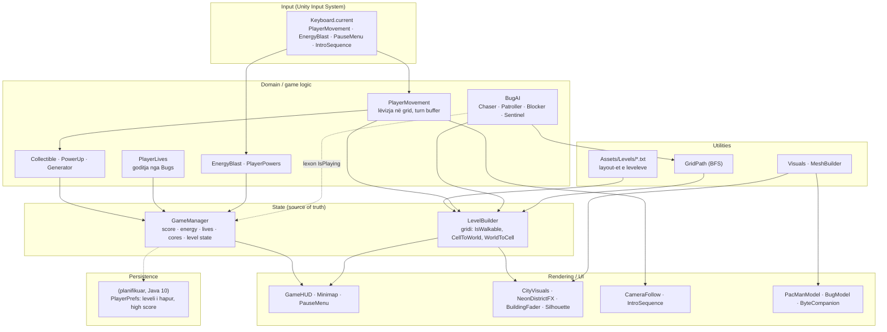

# PBT 7 – Arkitektura e lojës: PAC-MAN: NEXUS

Ekipi: Vjola Gallapeni, Vlosa Stagova, Enita Halimi · Java 8 · Architecture v1.0 · 15.11.2026

Dorëzimet e kërkuara te PBT 7 dhe ku gjenden:

| Artefakti | Ku |
| --- | --- |
| Architecture v1.0 (diagrami) | Seksioni 1 më poshtë |
| Interface notes | Seksioni 3 |
| Playable vertical slice v0.1 | `Assets/Scenes/Level1_NeonDistrict.unity` (+ Level 2) |
| Code review record | Seksioni 5 |

## 1. Diagrami i arkitekturës

Rregulli kryesor: **gjendja e lojës është në `GameManager`, gridi në `LevelBuilder`.** Moduli i lojtarit, Bugs dhe UI-ja i lexojnë këto dy module; nuk mbajnë kopje të vetat.

Si kalon një frame (bird's-eye view): Unity thërret `Update()` → `PlayerMovement` lexon tastet dhe lëviz një qelizë → `Collectible` / `PowerUp` / `Generator` njoftojnë `GameManager` → `BugAI` llogarit hapin e radhës me `GridPath` → `PlayerLives` kontrollon goditjen → `OnGUI()` vizaton HUD-in dhe minimapin nga `GameManager` dhe `LevelBuilder`.

## 2. Modulet dhe përgjegjësitë

| Moduli | Përgjegjësia | Varet nga |
| --- | --- | --- |
| `LevelBuilder` | Lexon layout-in tekstual, ndërton gridin dhe objektet, mban `IsWalkable` | Layout `.txt`, `Visuals` |
| `GameManager` | Score, energy, lives, Nexus Cores, level complete / game over, kalimi te leveli tjetër | `IntroSequence.Active`, `PauseMenu.Paused` |
| `GridPath` | BFS: rruga më e shkurtër (`TryFirstStep`), qelizat brenda N hapave (`CellsWithin`) | `LevelBuilder` |
| `PlayerMovement` | Lëvizja qelizë pas qelize, turn buffer 2.5 s, smart turn, lane change | `LevelBuilder`, `GameManager.IsPlaying` |
| `BugAI` | Sjellja e 4 llojeve të Bugs, Devour (ikin), knockback nga Energy Blast | `GridPath`, `LevelBuilder`, `GameManager` |
| `PlayerLives` | Goditja nga Bugs, 3 s invulnerability, respawn | `GameManager`, `BugAI`, `PlayerPowers` (shield) |
| `EnergyBlast`, `PlayerPowers` | Aftësitë e lojtarit dhe power-ups (Devour, Speed, Shield, Magnet) | `GameManager`, `BugAI` |
| `Collectible`, `PowerUp`, `Generator` | Objektet që mblidhen dhe objektivi i levelit | `GameManager` |
| `GameHUD`, `Minimap`, `PauseMenu` | UI (IMGUI); vetëm lexojnë gjendjen | `GameManager`, `LevelBuilder` |
| `CityVisuals`, `NeonDistrictFX`, `BuildingFader`, `Silhouette` | Pamja e qytetit; nuk ndryshojnë rregullat | `LevelBuilder` |
| `IntroSequence`, `CameraFollow` | Intro, kartat e leveleve, kamera | `PlayerMovement` |
| `Autopilot`, `NexusPlayTests` | Testim automatik | `PlayerMovement`, `GameManager` |

## 3. Interface notes (kontratat mes moduleve)

**`LevelBuilder` (gridi)**
- `static Instance`, `Width`, `Height`, `CoreCount`, `PlayerStart`, `GeneratorCell`, `BugSpawns`
- `IsWalkable(Vector2Int)`, `CellToWorld(Vector2Int)`, `WorldToCell(Vector3)`
- Kontrata: rreshti 0 = lart; y rritet poshtë. Askush tjetër nuk e ndryshon gridin.

**`GameManager` (gjendja)**
- Lexim: `Score`, `Energy`, `Lives`, `CoresCollected`, `CoresRequired`, `AllCoresCollected`, `LevelComplete`, `GameOver`, `IsPlaying`, `HasNextLevel`
- Ndryshim vetëm përmes metodave: `CollectOrb()`, `CollectCore()`, `AddScore(int)`, `UseEnergy(float)`, `LoseLife()`, `CompleteLevel()`, `Restart()`
- Ngjarje: `OnAllCoresCollected`, `OnLevelComplete`, `OnLifeLost`, `OnGameOver`
- Kontrata: kur `IsPlaying == false` (intro, pauzë, game over, level complete), lojtari dhe Bugs nuk lëvizin.

**`GridPath` (BFS)**
- `TryFirstStep(level, from, to, maxDistance, out step, out distance)`: hapi i parë i rrugës më të shkurtër
- `CellsWithin(level, from, steps)`: qelizat e arritshme brenda N hapave
- Kontrata: funksione statike pa gjendje të jashtme; lexojnë vetëm `IsWalkable`.

**`PlayerMovement`**
- `static Instance`, `CurrentCell`, `TargetCell`, `Direction`, `HasStarted`, `SetQueuedDirection(Vector2Int)`, `Respawn()`

**`BugAI`**
- `Init(level, type, start, routeEnd)`, `MakeVulnerable(seconds, warning)`, `Eat()`, `Knockback(from, push, freeze)`, `ResetToSpawn()`

**`PlayerPowers`**
- `Activate(PowerUpType, at)`, `DevourActive`, `HasShield`, `ConsumeShield()`, `NextEatScore()`, ngjarja `OnActivated`

## 4. Engine-dependent dhe domain logic

| Domain logic (rregullat e lojës) | Engine-dependent (Unity) |
| --- | --- |
| Formati i layout-it dhe gridi (`LevelBuilder` pjesa e leximit) | `MonoBehaviour`, `Update()`, `OnGUI()` |
| BFS në `GridPath` | Kamera, dritat, URP post-processing, bloom |
| Rregullat e `GameManager`: score, energy, 3 jetë, 10 cores, fitorja | Modelet 3D (Kenney FBX), materialet, shaderi i silhouette |
| Sjellja e Bugs (çka zgjedh secili lloj) | Input System (`Keyboard.current`) |
| Kohëzgjatja e power-ups, kostoja e Energy Blast | Ngarkimi i skenave (`SceneManager`, `EditorSceneManager`) |

Rregulli: pamja nuk ndryshon logjikën e gridit. Mund ta ndërrojmë krejt artin e qytetit pa prekur `LevelBuilder`, `GridPath` apo `GameManager`.

## 5. Code review record

**Data:** 15.11.2026 · **Reviewer:** Claude (AI), bashkë me ekipin · **Kodi:** `Assets/Scripts`

| # | Kontrolli | Rezultati | Shënim |
| --- | --- | --- | --- |
| 1 | Logjika e lojës e ndarë nga UI/rendering | Po | HUD dhe Minimap vetëm lexojnë `GameManager`; vizualet nuk prekin gridin |
| 2 | Një burim i vetëm për state-in | Po | `GameManager` (gjendja), `LevelBuilder` (gridi) |
| 3 | Input vetëm me Input System të ri | Po | Kodi aktiv përdor vetëm `Keyboard.current`, jo `Input.GetKey` |
| 4 | Emra të qartë, namespace `Nexus` | Po | |
| 5 | Kod i vdekur | Problem | Skriptet e vjetra classic në rrënjë të `Assets/Scripts` (pas `#if PACMAN_CLASSIC`). Duhen zhvendosur në `Demo_Backup/` ose fshirë. |
| 6 | Madhësia e file-ave | Problem | `CityVisuals.cs` (~44 KB), `IntroSequence.cs` (~37 KB), `GameHUD.cs` (~25 KB) duhen ndarë në klasa më të vogla. |
| 7 | Coupling | Pjesërisht | `GameManager.IsPlaying` varet nga `IntroSequence.Active` dhe `PauseMenu.Paused`. Shumë klasa përdorin `static Instance` (singleton): e thjeshtë, por e vështirë për testim. |
| 8 | Vlera të fiksuara në kod | Pjesërisht | Ngjyrat e Bugs për çdo level janë në `BugAI.ColorFor`; më mirë në një `ScriptableObject` për çdo level. |
| 9 | Testim | Po | `Autopilot` e kalon Level 1 dhe 2 me Bugs të ndezur (PASS); `NexusPlayTests` teston jetët. |
| 10 | Persistence | Mungon | Nuk ruhet progresi apo high score-i. Planifikuar për Javën 10 (Memory & I/O). |

Veprimet pas review-it: (1) zhvendosja e kodit classic, (2) ndarja e `CityVisuals` sipas temës së levelit, (3) `LevelData` si `ScriptableObject` për ngjyrat dhe Bugs, (4) ruajtja me `PlayerPrefs`.

## 6. Përgjigjet për pyetjet e checkpoint-it

**Cili modul e mban source of truth të state-it?** `GameManager` për score, energy, lives, cores dhe gjendjen e levelit. `LevelBuilder` për gridin. Të tjerët i lexojnë ose i ndryshojnë vetëm përmes metodave të tyre.

**Cili coupling është i panevojshëm?** `GameManager` që pyet direkt `IntroSequence` dhe `PauseMenu`; më mirë do të ishte një enum `GameState` (Intro, Playing, Paused, LevelComplete, GameOver) brenda `GameManager`. Edhe ngjyrat e Bugs që varen nga tema e qytetit.

**Çfarë do të testonit pa e hapur UI-në?** BFS-në në `GridPath` (rruga më e shkurtër në një grid të vogël), leximin e layout-it (10 cores, 1 start, 1 generator), rregullat e `GameManager` (3 jetë → game over, 10 cores → generator aktiv), dhe `Autopilot` që e kalon levelin vetë dhe shkruan PASS/FAIL në Console.

## 7. Raporti 3-minutësh i javës

1. **Sprint goal:** sistemi i ndarë në module dhe vertical slice i luajtshëm nga fillimi në fund.
2. **Çka u përfundua:** intro, Level 1 Neon District dhe Level 2 Skyline Zone, 4 lloje Bugs me BFS, power-ups, HUD me minimap, pause menu, test automatik.
3. **Evidenca:** repo `github.com/stagovaVlosa/pacman-nexus`; Autopilot PASS (Level 1: 10/10 cores, 48 s, 3 jetë).
4. **Problem real:** te Level 2, Sentinels qëndronin mbi cores dhe disa cores ishin të paarritshme. E zgjidhëm duke ndryshuar sjelljen (patrullim 4 hapa larg core-it) dhe duke hequr dead ends nga harta.
5. **Çka mësuam:** testimi automatik (Autopilot) i gjen problemet e hartës më shpejt se loja me dorë; vizualet duhet të mbahen të ndara nga gridi.
6. **Blocker / risk:** performanca e Level 1 (~34 FPS në editor me ~2400 objekte); zëri dhe muzika ende mungojnë.
7. **Objektivi i javës tjetër:** Level 3 Underground Transit Maze me Glitch, main menu, zë dhe muzikë, ruajtja e progresit.
